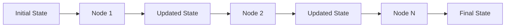

## Communication Layers

### 1. Vertical Communication (Hierarchical)

```
┌─────────────────────────────────────────────────────┐
│                    User Layer                       │
│              (External Interface)                   │
└───────────────────┬─────────────────────────────────┘
                    │
                    │ HTTP/API/CLI
                    │
┌───────────────────▼─────────────────────────────────┐
│                Coordinator Layer                    │
│          (Initial Request Processing)               │
└───────────────────┬─────────────────────────────────┘
                    │
                    │ State Messages
                    │
┌───────────────────▼─────────────────────────────────┐
│                  Planner Layer                      │
│            (Task Decomposition)                     │
└───────────────────┬─────────────────────────────────┘
                    │
                    │ Execution Plans
                    │
┌───────────────────▼─────────────────────────────────┐
│                Supervisor Layer                     │
│              (Team Coordination)                    │
└───────┬─────┬─────┬─────┬─────┬─────────────────────┘
        │     │     │     │     │
        │     │     │     │     │ Task Distribution
        │     │     │     │     │
┌───────▼─────▼─────▼─────▼─────▼─────────────────────┐
│              Execution Layer                        │
│        (Teams & Individual Agents)                  │
└───────┬─────┬─────┬─────┬─────┬─────────────────────┘
        │     │     │     │     │
        │     │     │     │     │ Results
        │     │     │     │     │
┌───────▼─────▼─────▼─────▼─────▼─────────────────────┐
│              Response Generator                     │
│            (Output Synthesis)                       │
└─────────────────────────────────────────────────────┘
```

### 2. Horizontal Communication (Peer-to-Peer)

```
┌──────────┐     ┌──────────┐     ┌──────────┐
│  Team A  │────▶│Supervisor│◀────│  Team B  │
└──────────┘     └────┬─────┘     └──────────┘
                      │
                      │ Coordination
                      │
                 ┌────▼─────┐
                 │  Team C  │
                 └──────────┘
```

### 3. Internal Communication (Agent-Level)

```
┌─────────────────────────────────────────────────────┐
│                      Agent                          │
│                                                     │
│  ┌──────────┐    ┌──────────┐    ┌──────────┐   │
│  │   LLM    │◀───│  Memory  │───▶│  Tools   │   │
│  └──────────┘    └──────────┘    └──────────┘   │
│       │               │                │          │
│       └───────────────┴────────────────┘          │
│                  State Updates                     │
└─────────────────────────────────────────────────────┘
```

---

## Message Flow Patterns

### 1. Request-Response Pattern

**Use Case**: Synchronous operations requiring immediate feedback

```python
# Example: Coordinator to Planner
def coordinator_to_planner(state: State) -> State:
    """Send request and wait for response."""
    return {
        "messages": state["messages"] + [
            AIMessage(content="Request: Analyze this task")
        ],
        "next": "planner"
    }

# Planner processes and responds
def planner_response(state: State) -> State:
    """Process request and return response."""
    response = llm.invoke(state["messages"])
    return {
        "messages": state["messages"] + [response],
        "full_plan": extract_plan(response),
        "next": "supervisor"
    }
```

### 2. Broadcast Pattern

**Use Case**: Distributing information to multiple recipients

```python
# Example: Supervisor broadcasting to teams
def broadcast_to_teams(state: State, teams: List[str]) -> State:
    """Broadcast message to all teams."""
    context = state.get("context", {})
    context["broadcast_recipients"] = teams
    context["broadcast_message"] = state["messages"][-1]

    return {
        **state,
        "context": context,
        "next": teams[0]  # Start with first team
    }
```

### 3. Pipeline Pattern

**Use Case**: Sequential processing through multiple stages

```python
# Example: Multi-stage processing
def pipeline_flow(initial_state: State) -> State:
    """Process through pipeline stages."""

    # Stage 1: Coordinator
    state = coordinator_node(initial_state)

    # Stage 2: Planner
    if state["next"] == "planner":
        state = planner_node(state)

    # Stage 3: Teams (via supervisor)
    if state["next"] != "__end__":
        state = supervisor_node(state)

    # Stage 4: Generator
    state = generator_node(state)

    return state
```

### 4. Event-Driven Pattern

**Use Case**: Asynchronous operations and notifications

```python
# Example: Event-based communication
class EventBus:
    """Central event bus for async communication."""

    def __init__(self):
        self.subscribers = defaultdict(list)

    def subscribe(self, event_type: str, handler: Callable):
        """Subscribe to events."""
        self.subscribers[event_type].append(handler)

    def publish(self, event_type: str, data: Any):
        """Publish event to subscribers."""
        for handler in self.subscribers[event_type]:
            handler(data)

# Usage
event_bus = EventBus()
event_bus.subscribe("task_completed", notify_supervisor)
event_bus.publish("task_completed", {"team": "research", "status": "done"})
```

---

## State-Based Communication

### State Structure

```python
class State(MessagesState):
    """
    Central state object for all communications.
    """
    messages: List[AnyMessage]      # Message history
    next: str                        # Next node to visit
    full_plan: str                   # Execution plan
    context: Dict[str, Any]          # Shared context
    metadata: Dict[str, Any]         # Metadata
    rl_metadata: Dict[str, Any]      # RL-specific data
```

### State Updates

```python
# Example: Adding information to state
def update_state_with_team_result(state: State, team_name: str, result: str) -> State:
    """Update state with team result."""

    # Add result message
    messages = state["messages"] + [
        AIMessage(content=result, name=team_name)
    ]

    # Update context
    context = state.get("context", {}).copy()
    context[f"{team_name}_result"] = result
    context["last_team"] = team_name

    # Update metadata
    metadata = state.get("metadata", {}).copy()
    metadata["teams_executed"] = metadata.get("teams_executed", []) + [team_name]

    return {
        **state,
        "messages": messages,
        "context": context,
        "metadata": metadata
    }
```

### State Propagation



---

## Inter-Agent Communication

### 1. Direct Agent-to-Agent

```python
class AgentCommunicator:
    """Handles direct agent communication."""

    def send_message(
        self,
        sender: str,
        receiver: str,
        message: str,
        state: State
    ) -> State:
        """Send direct message between agents."""

        # Create structured message
        msg = AIMessage(
            content=message,
            name=sender,
            additional_kwargs={"recipient": receiver}
        )

        # Update state
        messages = state["messages"] + [msg]
        context = state.get("context", {}).copy()
        context[f"msg_{sender}_to_{receiver}"] = message

        return {
            **state,
            "messages": messages,
            "context": context
        }

    def receive_messages(
        self,
        agent: str,
        state: State
    ) -> List[AIMessage]:
        """Get messages for specific agent."""
        return [
            msg for msg in state["messages"]
            if msg.additional_kwargs.get("recipient") == agent
        ]
```

### 2. Shared Memory Communication

```python
class SharedMemory:
    """Shared memory space for inter-agent communication."""

    def __init__(self):
        self.memory: Dict[str, Any] = {}
        self.locks: Dict[str, threading.Lock] = {}

    def write(self, key: str, value: Any, agent: str):
        """Write to shared memory."""
        if key not in self.locks:
            self.locks[key] = threading.Lock()

        with self.locks[key]:
            self.memory[key] = {
                "value": value,
                "writer": agent,
                "timestamp": datetime.now()
            }

    def read(self, key: str) -> Optional[Any]:
        """Read from shared memory."""
        if key in self.memory:
            return self.memory[key]["value"]
        return None

    def read_all_by_agent(self, agent: str) -> Dict[str, Any]:
        """Read all entries written by specific agent."""
        return {
            k: v["value"]
            for k, v in self.memory.items()
            if v["writer"] == agent
        }
```

### 3. Message Queue Pattern

```python
from queue import Queue
from threading import Thread

class MessageQueue:
    """Asynchronous message queue for agent communication."""

    def __init__(self):
        self.queues: Dict[str, Queue] = {}

    def create_queue(self, agent: str):
        """Create queue for agent."""
        if agent not in self.queues:
            self.queues[agent] = Queue()

    def send_async(self, sender: str, receiver: str, message: Any):
        """Send message asynchronously."""
        if receiver not in self.queues:
            self.create_queue(receiver)

        self.queues[receiver].put({
            "sender": sender,
            "message": message,
            "timestamp": datetime.now()
        })

    def receive(self, agent: str, timeout: Optional[float] = None) -> Optional[Dict]:
        """Receive message from queue."""
        if agent not in self.queues:
            return None

        try:
            return self.queues[agent].get(timeout=timeout)
        except:
            return None

    def get_all(self, agent: str) -> List[Dict]:
        """Get all messages for agent."""
        messages = []
        while not self.queues.get(agent, Queue()).empty():
            messages.append(self.queues[agent].get())
        return messages
```

---

## Team Communication

### 1. Team Coordination

```python
class TeamCommunicator:
    """Manages communication within and between teams."""

    def __init__(self, team_name: str):
        self.team_name = team_name
        self.internal_state: Dict[str, Any] = {}

    def broadcast_to_team(self, message: str, state: State) -> State:
        """Broadcast message to all team members."""
        context = state.get("context", {}).copy()
        context[f"{self.team_name}_broadcast"] = {
            "message": message,
            "timestamp": datetime.now().isoformat()
        }

        return {
            **state,
            "context": context
        }

    def report_to_supervisor(self, result: str, state: State) -> State:
        """Report team results to supervisor."""
        msg = AIMessage(
            content=f"Team {self.team_name} report: {result}",
            name=self.team_name
        )

        context = state.get("context", {}).copy()
        context[f"{self.team_name}_status"] = "completed"

        return {
            **state,
            "messages": state["messages"] + [msg],
            "context": context,
            "next": "supervisor"
        }

    def request_assistance(
        self,
        target_team: str,
        request: str,
        state: State
    ) -> State:
        """Request assistance from another team."""
        context = state.get("context", {}).copy()
        context["assistance_request"] = {
            "from": self.team_name,
            "to": target_team,
            "request": request
        }

        return {
            **state,
            "context": context,
            "next": target_team
        }
```

### 2. Team-to-Team Communication

```python
def enable_team_collaboration(
    team_a: str,
    team_b: str,
    shared_resources: List[str]
) -> Callable:
    """Enable collaboration between teams."""

    def collaborate(state: State) -> State:
        """Collaborative processing."""
        context = state.get("context", {}).copy()

        # Share resources
        context["shared_resources"] = {
            "teams": [team_a, team_b],
            "resources": shared_resources,
            "collaboration_id": str(uuid.uuid4())
        }

        # Track collaboration
        metadata = state.get("metadata", {}).copy()
        metadata["collaborations"] = metadata.get("collaborations", [])
        metadata["collaborations"].append({
            "teams": [team_a, team_b],
            "timestamp": datetime.now().isoformat()
        })

        return {
            **state,
            "context": context,
            "metadata": metadata
        }

    return collaborate
```

---

## Supervisor Communication

### 1. Supervisor-to-Team Routing

```python
class SupervisorCommunicator:
    """Manages supervisor communication patterns."""

    def __init__(self, llm, members: List[str]):
        self.llm = llm
        self.members = members

    def route_to_team(self, state: State) -> str:
        """Route to appropriate team based on state."""

        # Get last messages
        messages = state["messages"]
        plan = state.get("full_plan", "")

        # Prepare routing prompt
        routing_prompt = f"""
        Based on the conversation and plan, which team should handle this?

        Available teams: {', '.join(self.members)}
        Plan: {plan}

        Last message: {messages[-1].content if messages else 'None'}

        Respond with just the team name, or 'FINISH' if done.
        """

        # Get routing decision
        response = self.llm.invoke([HumanMessage(content=routing_prompt)])
        next_team = response.content.strip()

        # Log routing decision
        logger.info(f"Supervisor routing to: {next_team}")

        return next_team if next_team != "FINISH" else "response_generator"

    def aggregate_team_results(self, state: State) -> str:
        """Aggregate results from multiple teams."""
        context = state.get("context", {})

        results = []
        for member in self.members:
            result = context.get(f"{member}_result")
            if result:
                results.append(f"**{member}**: {result}")

        return "\n\n".join(results)
```

### 2. Multi-Team Coordination

```python
def coordinate_multiple_teams(
    supervisor: Supervisor,
    teams: List[str],
    state: State
) -> State:
    """Coordinate execution across multiple teams."""

    results = []
    current_state = state

    for team in teams:
        # Route to team
        current_state["next"] = team

        # Execute team
        team_result = execute_team(team, current_state)
        results.append(team_result)

        # Update state with result
        current_state = update_state_with_team_result(
            current_state,
            team,
            team_result["messages"][-1].content
        )

    # Aggregate results
    aggregated = supervisor_communicator.aggregate_team_results(current_state)

    return {
        **current_state,
        "context": {
            **current_state["context"],
            "aggregated_results": aggregated
        },
        "next": "response_generator"
    }
```

---

## LLM Communication

### 1. LLM Request Structure

```python
class LLMCommunicator:
    """Handles communication with LLM providers."""

    def __init__(self, llm):
        self.llm = llm
        self.cache = LRUCache(max_size=1000)

    def invoke_with_cache(
        self,
        messages: List[BaseMessage],
        cache_key: Optional[str] = None
    ) -> AIMessage:
        """Invoke LLM with caching."""

        # Generate cache key
        if not cache_key:
            cache_key = self._generate_cache_key(messages)

        # Check cache
        cached = self.cache.get(cache_key)
        if cached:
            logger.debug("Cache hit for LLM request")
            return cached

        # Call LLM
        response = self.llm.invoke(messages)

        # Cache response
        self.cache.put(cache_key, response)

        return response

    def invoke_with_retry(
        self,
        messages: List[BaseMessage],
        max_retries: int = 3
    ) -> AIMessage:
        """Invoke LLM with retry logic."""

        for attempt in range(max_retries):
            try:
                return self.llm.invoke(messages)
            except Exception as e:
                logger.warning(f"LLM call failed (attempt {attempt + 1}): {e}")
                if attempt == max_retries - 1:
                    raise
                time.sleep(2 ** attempt)  # Exponential backoff

    def stream_response(
        self,
        messages: List[BaseMessage]
    ) -> Iterator[str]:
        """Stream LLM response in chunks."""

        for chunk in self.llm.stream(messages):
            if hasattr(chunk, 'content'):
                yield chunk.content

    @staticmethod
    def _generate_cache_key(messages: List[BaseMessage]) -> str:
        """Generate cache key from messages."""
        content = "".join([m.content for m in messages])
        return hashlib.md5(content.encode()).hexdigest()
```

### 2. Structured LLM Output

```python
from pydantic import BaseModel
from typing import List

class TaskDecomposition(BaseModel):
    """Structured output for task decomposition."""
    subtasks: List[str]
    teams: List[str]
    order: str  # "sequential" or "parallel"
    reasoning: str

def get_structured_response(
    llm,
    messages: List[BaseMessage],
    output_model: Type[BaseModel]
) -> BaseModel:
    """Get structured response from LLM."""

    # Add schema to prompt
    schema_prompt = f"""
    Respond in JSON format matching this schema:
    {output_model.schema_json(indent=2)}
    """

    messages_with_schema = messages + [
        HumanMessage(content=schema_prompt)
    ]

    # Get response
    response = llm.invoke(messages_with_schema)

    # Parse and validate
    try:
        data = json.loads(response.content)
        return output_model(**data)
    except Exception as e:
        logger.error(f"Failed to parse structured response: {e}")
        raise
```

---

## Tool Communication

### 1. Tool Invocation

```python
class ToolCommunicator:
    """Manages tool communication and execution."""

    def __init__(self, tools: List[BaseTool]):
        self.tools = {tool.name: tool for tool in tools}

    def invoke_tool(
        self,
        tool_name: str,
        args: Dict[str, Any],
        state: State
    ) -> Tuple[Any, State]:
        """Invoke tool and update state."""

        if tool_name not in self.tools:
            raise ValueError(f"Unknown tool: {tool_name}")

        # Execute tool
        tool = self.tools[tool_name]
        result = tool.invoke(args)

        # Update state with tool execution
        metadata = state.get("metadata", {}).copy()
        metadata["tool_executions"] = metadata.get("tool_executions", [])
        metadata["tool_executions"].append({
            "tool": tool_name,
            "args": args,
            "result": str(result)[:100],  # Truncate
            "timestamp": datetime.now().isoformat()
        })

        updated_state = {
            **state,
            "metadata": metadata
        }

        return result, updated_state

    def invoke_tool_async(
        self,
        tool_name: str,
        args: Dict[str, Any]
    ) -> asyncio.Future:
        """Invoke tool asynchronously."""

        async def execute():
            tool = self.tools[tool_name]
            if hasattr(tool, 'ainvoke'):
                return await tool.ainvoke(args)
            else:
                return tool.invoke(args)

        return asyncio.ensure_future(execute())
```

### 2. Tool Result Broadcasting

```python
def broadcast_tool_results(
    results: List[Any],
    state: State,
    recipients: List[str]
) -> State:
    """Broadcast tool results to multiple recipients."""

    context = state.get("context", {}).copy()

    for recipient in recipients:
        context[f"{recipient}_tool_results"] = results

    # Add notification message
    notification = AIMessage(
        content=f"Tool results available for: {', '.join(recipients)}",
        name="system"
    )

    return {
        **state,
        "messages": state["messages"] + [notification],
        "context": context
    }
```

---

## Error Communication

### 1. Error Propagation

```python
class ErrorCommunicator:
    """Manages error communication throughout the system."""

    @staticmethod
    def propagate_error(
        error: Exception,
        source: str,
        state: State
    ) -> State:
        """Propagate error through state."""

        # Create error message
        error_msg = AIMessage(
            content=f"Error in {source}: {str(error)}",
            name="system_error",
            additional_kwargs={
                "error_type": type(error).__name__,
                "source": source,
                "timestamp": datetime.now().isoformat()
            }
        )

        # Update state
        metadata = state.get("metadata", {}).copy()
        metadata["errors"] = metadata.get("errors", [])
        metadata["errors"].append({
            "type": type(error).__name__,
            "message": str(error),
            "source": source,
            "timestamp": datetime.now().isoformat()
        })

        return {
            **state,
            "messages": state["messages"] + [error_msg],
            "metadata": metadata
        }

    @staticmethod
    def handle_error_recovery(
        error: Exception,
        state: State,
        recovery_strategy: str = "retry"
    ) -> State:
        """Handle error with recovery strategy."""

        context = state.get("context", {}).copy()
        context["error_recovery"] = {
            "strategy": recovery_strategy,
            "error": str(error),
            "timestamp": datetime.now().isoformat()
        }

        if recovery_strategy == "retry":
            context["retry_count"] = context.get("retry_count", 0) + 1
        elif recovery_strategy == "fallback":
            context["use_fallback"] = True
        elif recovery_strategy == "abort":
            context["abort"] = True

        return {
            **state,
            "context": context
        }
```

### 2. Error Notification

```python
def notify_error(
    error: Exception,
    recipients: List[str],
    state: State
) -> State:
    """Notify multiple recipients about error."""

    error_message = f"""
    🚨 Error Notification

    Type: {type(error).__name__}
    Message: {str(error)}
    Recipients: {', '.join(recipients)}
    Timestamp: {datetime.now().isoformat()}
    """

    # Add to messages
    notification = AIMessage(
        content=error_message,
        name="error_notifier",
        additional_kwargs={"recipients": recipients}
    )

    # Update context
    context = state.get("context", {}).copy()
    for recipient in recipients:
        context[f"{recipient}_error_notification"] = error_message

    return {
        **state,
        "messages": state["messages"] + [notification],
        "context": context
    }
```

---

## Real-Time Updates

### 1. Streaming Updates

```python
class StreamingCommunicator:
    """Provides real-time streaming updates."""

    def __init__(self):
        self.subscribers: Dict[str, List[Callable]] = defaultdict(list)

    def subscribe(self, channel: str, callback: Callable):
        """Subscribe to a channel."""
        self.subscribers[channel].append(callback)

    def stream_update(self, channel: str, update: Any):
        """Stream update to subscribers."""
        for callback in self.subscribers[channel]:
            try:
                callback(update)
            except Exception as e:
                logger.error(f"Subscriber callback failed: {e}")

    def stream_graph_execution(self, state: State, node: str):
        """Stream graph execution updates."""
        update = {
            "node": node,
            "timestamp": datetime.now().isoformat(),
            "messages_count": len(state.get("messages", [])),
            "current_state": {
                "next": state.get("next", ""),
                "has_plan": bool(state.get("full_plan", ""))
            }
        }

        self.stream_update("graph_execution", update)
```

### 2. Progress Tracking

```python
class ProgressCommunicator:
    """Tracks and communicates progress."""

    def __init__(self, total_steps: int):
        self.total_steps = total_steps
        self.current_step = 0
        self.callbacks: List[Callable] = []

    def add_callback(self, callback: Callable):
        """Add progress callback."""
        self.callbacks.append(callback)

    def update_progress(self, step_name: str, state: State):
        """Update progress and notify callbacks."""
        self.current_step += 1
        progress = (self.current_step / self.total_steps) * 100

        update = {
            "step": step_name,
            "progress": progress,
            "timestamp": datetime.now().isoformat()
        }

        # Notify callbacks
        for callback in self.callbacks:
            callback(update)

        # Update state
        metadata = state.get("metadata", {}).copy()
        metadata["progress"] = progress
        metadata["current_step"] = step_name

        return {
            **state,
            "metadata": metadata
        }
```

---

## Communication Protocols

### 1. Message Protocol

```python
@dataclass
class Message:
    """Standard message protocol."""
    sender: str
    receiver: str
    content: Any
    message_type: str  # "request", "response", "notification", "error"
    timestamp: datetime
    metadata: Dict[str, Any] = field(default_factory=dict)

    def to_langchain_message(self) -> BaseMessage:
        """Convert to LangChain message."""
        return AIMessage(
            content=str(self.content),
            name=self.sender,
            additional_kwargs={
                "receiver": self.receiver,
                "message_type": self.message_type,
                "timestamp": self.timestamp.isoformat(),
                **self.metadata
            }
        )

    @classmethod
    def from_langchain_message(cls, msg: BaseMessage) -> "Message":
        """Create from LangChain message."""
        kwargs = msg.additional_kwargs
        return cls(
            sender=msg.name or "unknown",
            receiver=kwargs.get("receiver", "unknown"),
            content=msg.content,
            message_type=kwargs.get("message_type", "notification"),
            timestamp=datetime.fromisoformat(kwargs.get("timestamp", datetime.now().isoformat())),
            metadata={k: v for k, v in kwargs.items() if k not in ["receiver", "message_type", "timestamp"]}
        )
```

### 2. Context Protocol

```python
class ContextProtocol:
    """Protocol for managing shared context."""

    @staticmethod
    def create_context(initial_data: Dict[str, Any] = None) -> Dict[str, Any]:
        """Create new context."""
        return {
            "created_at": datetime.now().isoformat(),
            "version": "1.0",
            "data": initial_data or {},
            "history": []
        }

    @staticmethod
    def update_context(
        context: Dict[str, Any],
        key: str,
        value: Any,
        source: str
    ) -> Dict[str, Any]:
        """Update context with tracking."""
        updated = context.copy()

        # Update data
        updated["data"][key] = value

        # Track history
        updated["history"].append({
            "key": key,
            "value": value,
            "source": source,
            "timestamp": datetime.now().isoformat()
        })

        return updated

    @staticmethod
    def merge_contexts(
        context1: Dict[str, Any],
        context2: Dict[str, Any]
    ) -> Dict[str, Any]:
        """Merge two contexts."""
        merged = context1.copy()
        merged["data"].update(context2["data"])
        merged["history"].extend(context2["history"])
        return merged
```

### 3. State Synchronization Protocol

```python
class StateSynchronizer:
    """Synchronizes state across distributed components."""

    def __init__(self):
        self.version = 0
        self.lock = threading.Lock()

    def sync_state(
        self,
        local_state: State,
        remote_state: State
    ) -> State:
        """Synchronize local and remote states."""

        with self.lock:
            # Merge messages
            local_msgs = set(msg.content for msg in local_state["messages"])
            remote_msgs = [msg for msg in remote_state["messages"] if msg.content not in local_msgs]

            merged_messages = local_state["messages"] + remote_msgs

            # Merge context (remote takes precedence)
            merged_context = {
                **local_state.get("context", {}),
                **remote_state.get("context", {})
            }

            # Increment version
            self.version += 1

            return {
                **local_state,
                "messages": merged_messages,
                "context": merged_context,
                "metadata": {
                    **local_state.get("metadata", {}),
                    "sync_version": self.version,
                    "last_sync": datetime.now().isoformat()
                }
            }
```

---

## Best Practices

### 1. Message Design

```python
# ✅ Good: Clear, structured messages
good_message = AIMessage(
    content="Task completed successfully",
    name="research_team",
    additional_kwargs={
        "status": "completed",
        "duration": 2.5,
        "results_count": 10
    }
)

# ❌ Bad: Unstructured, unclear messages
bad_message = AIMessage(
    content="done"
)
```

### 2. State Management

```python
# ✅ Good: Immutable state updates
def update_state_good(state: State, new_data: Dict) -> State:
    return {
        **state,
        "context": {
            **state.get("context", {}),
            **new_data
        }
    }

# ❌ Bad: Mutating state directly
def update_state_bad(state: State, new_data: Dict) -> State:
    state["context"].update(new_data)  # Mutates original!
    return state
```

### 3. Error Handling

```python
# ✅ Good: Comprehensive error handling
def communicate_safely(state: State) -> State:
    try:
        result = perform_communication(state)
        return result
    except ConnectionError as e:
        logger.error(f"Connection failed: {e}")
        return propagate_error(e, "communication", state)
    except Exception as e:
        logger.exception("Unexpected error")
        return handle_error_recovery(e, state, "fallback")

# ❌ Bad: Silent failures
def communicate_badly(state: State) -> State:
    try:
        return perform_communication(state)
    except:
        pass  # Error lost!
```

### 4. Communication Patterns

```python
# ✅ Good: Async for I/O-bound operations
async def communicate_async(state: State) -> State:
    tasks = [
        fetch_data_async(source)
        for source in data_sources
    ]
    results = await asyncio.gather(*tasks)
    return update_state_with_results(state, results)

# ✅ Good: Sync for CPU-bound operations
def process_sync(state: State) -> State:
    results = [
        process_data(data)
        for data in state["context"]["data"]
    ]
    return update_state_with_results(state, results)
```

### 5. Logging and Monitoring

```python
# ✅ Good: Comprehensive logging
def communicate_with_logging(state: State) -> State:
    logger.info("Starting communication", extra={
        "messages_count": len(state["messages"]),
        "next_node": state.get("next")
    })

    start_time = time.time()
    result = perform_communication(state)
    duration = time.time() - start_time

    logger.info("Communication completed", extra={
        "duration": duration,
        "success": True
    })

    return result
```

---

## Communication Flow Examples

### Example 1: Simple Request-Response

```python
def simple_workflow():
    """Simple coordinator -> planner -> response flow."""

    # Initial state
    state = {
        "messages": [HumanMessage(content="Analyze security logs")],
        "next": "",
        "full_plan": "",
        "context": {},
        "metadata": {}
    }

    # Coordinator
    coordinator = CoordinatorNode(llm)
    state = coordinator(state)
    # state["next"] = "planner"

    # Planner
    planner = PlannerNode(llm)
    state = planner(state)
    # state["next"] = "supervisor"
    # state["full_plan"] = "..."

    # Supervisor routes to team
    supervisor = Supervisor(llm, members=["security_team"])
    state = supervisor(state)
    # state["next"] = "security_team"

    # Team executes
    team = SecurityTeam.create(llm)
    state = team(state)
    # state["next"] = "supervisor"

    # Supervisor routes to generator
    state = supervisor(state)
    # state["next"] = "response_generator"

    # Generator creates final response
    generator = ResponseGeneratorNode(llm)
    state = generator(state)
    # state["next"] = "__end__"

    return state["messages"][-1].content
```

### Example 2: Multi-Team Collaboration

```python
async def collaborative_workflow():
    """Multiple teams working together."""

    # Initial state
    state = create_initial_state(
        messages=[HumanMessage(content="Comprehensive system audit")],
        metadata={"workflow_type": "collaborative"}
    )

    # Coordinator and Planner
    state = await coordinator_node.ainvoke(state)
    state = await planner_node.ainvoke(state)

    # Parallel team execution
    teams = ["security_team", "performance_team", "compliance_team"]

    async def execute_team(team_name: str, state: State) -> State:
        team = get_team(team_name)
        return await team.ainvoke(state)

    # Execute all teams in parallel
    team_states = await asyncio.gather(*[
        execute_team(team, state)
        for team in teams
    ])

    # Merge results
    merged_state = merge_team_states(state, team_states)

    # Generate final response
    final_state = await response_generator.ainvoke(merged_state)

    return final_state
```

### Example 3: Error Recovery Flow

```python
def workflow_with_error_recovery():
    """Workflow with comprehensive error handling."""

    state = create_initial_state(
        messages=[HumanMessage(content="Complex analysis task")]
    )

    max_retries = 3
    retry_count = 0

    while retry_count < max_retries:
        try:
            # Execute workflow
            state = coordinator_node(state)
            state = planner_node(state)
            state = supervisor_node(state)

            # Execute assigned team
            team_name = state["next"]
            team = get_team(team_name)
            state = team(state)

            # Generate response
            state = response_generator(state)

            # Success!
            break

        except Exception as e:
            retry_count += 1
            logger.error(f"Workflow failed (attempt {retry_count}): {e}")

            # Update state with error
            state = propagate_error(e, "workflow", state)

            if retry_count < max_retries:
                # Apply recovery strategy
                state = handle_error_recovery(e, state, "retry")
                time.sleep(2 ** retry_count)
            else:
                # Max retries reached, use fallback
                state = apply_fallback_response(state)

    return state
```

---

## Conclusion

The Arc Framework's communication architecture provides:

1. **Flexible Communication Patterns**: Request-response, broadcast, pipeline, and event-driven
2. **Multi-Layer Communication**: Vertical (hierarchical) and horizontal (peer-to-peer)
3. **State Management**: Centralized state with immutable updates
4. **Error Handling**: Comprehensive error propagation and recovery
5. **Real-Time Updates**: Streaming and progress tracking
6. **Protocol Standards**: Well-defined message and context protocols
7. **Performance**: Caching, async support, and optimization

This architecture enables building complex, scalable, and maintainable multi-agent systems.

---

**Arc Framework v2.0** - Professional Communication Architecture